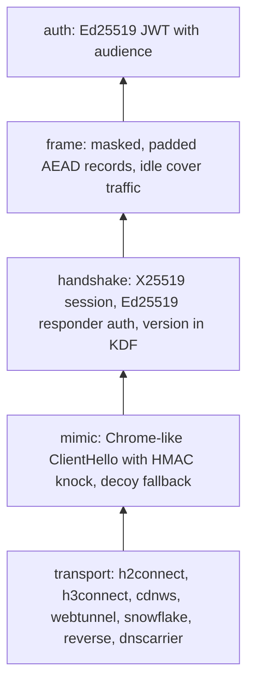

# dotvpn-wire

[](https://github.com/payam-foundation/dotvpn-wire/actions/workflows/ci.yml)
[](https://github.com/payam-foundation/dotvpn-wire/releases)
[](#status)
[](LICENSE)

The shared wire protocol of [dotvpn](#related-repositories): framing, authentication, handshake, carriers and discovery. Core, relay and client import this one library, so they cannot disagree about what goes on the wire.

It is a Go library only. There are no binaries.

## Status

Beta. The current wire version is `v0.2.0`. Expect breaking changes before `v1.0.0`; each one is announced as a major or minor version according to the [versioning contract](#versioning-and-compatibility).

## What it provides

| Capability | Package | What you get |
|---|---|---|
| Authentication | `auth` | Ed25519-signed JWTs with an audience claim (`""` data, `control`, `enroll`, `pool`). A node verifies tokens offline with the public key alone. |
| Record framing | `frame` | Masked, padded AEAD records, plus jittered idle cover traffic so a quiet tunnel does not look quiet. |
| Handshake | `handshake` | X25519 key exchange with Ed25519 responder authentication. The wire version is bound into the key derivation. |
| Probe resistance | `mimic` | A Chrome-like TLS ClientHello that carries an HMAC knock, and a classifier that tells a valid knock from a probe so the server can fall back to a decoy. |
| Carriers | `transport` and its adapters | One `Dialer` / `Listener` / `Backend` interface over HTTP/2 CONNECT, HTTP/3 CONNECT, CDN WebSocket, WebTunnel, Snowflake, a reverse pool and an in-memory transport for tests. TLS pins are checked in `VerifyConnection`, so they survive session resumption. |
| DNS carrier | `dnscarrier` | A DNS-shaped UDP carrier with KCP on top, for networks that let little else through. |
| Discovery and invites | `discovery`, `invite` | A signed server list and the `dotvpn://` invite string. |
| Safety helpers | `loopback`, `atomicfile` | Loopback-only listener checks for admin surfaces, and atomic 0600 config writes. |

## Architecture

Each layer talks only to its neighbour. Core, relay and client assemble the same stack, so a change in one layer is a change for every component.



## Use it

```sh
go get github.com/payam-foundation/dotvpn-wire@v0.2.0
```

Mint a short-lived token on the control plane and verify it offline on a node:

```go
pub, priv, _ := auth.GenerateKey()
tok, _ := auth.NewSigner(priv).Mint(auth.Claims{Sub: "user-1"}, 15*time.Minute)

claims, err := auth.NewVerifier(pub).Verify(tok) // claims.Sub == "user-1", err == nil

// A token minted for another audience is refused on the data plane.
pool, _ := auth.NewSigner(priv).Mint(auth.Claims{Sub: "node-1", Aud: auth.AudPool}, time.Minute)
_, err = auth.NewVerifier(pub).Verify(pool) // auth: wrong token audience
```

Runnable examples for `auth`, `frame`, `handshake` and `invite` are `Example` tests; read them in the package documentation or run `go test ./...`.

## Versioning and compatibility

Semantic versioning. The wire contract is `handshake.Version` plus the golden vectors in the `frame` and `handshake` tests.

- Changing a golden vector is a wire break. It requires a major version, or a new `handshake.Version` string while both are accepted.
- Consumers pin an exact tag. Each repository's CI runs the wire vectors against its pinned version.
- A wire major bump is a flag day for core, relay and client. Roll all three forward or back together.
- Every length-prefixed reader has a size cap, and every parser has a fuzz target.

Design decisions are recorded as ADRs: [Ed25519 JWT](docs/adr/003-ed25519-jwt.md), [direct and CDN carriers](docs/adr/004-connect-direct-websocket-cdn.md), [Snowflake and WebTunnel infrastructure](docs/adr/007-own-infra-snowflake-webtunnel.md), [signed server list](docs/adr/008-signed-server-list-discovery.md), [versioning](docs/adr/011-wire-versioning.md), [ECH policy](docs/adr/017-ech-policy.md) and [UDP over tunnel streams](docs/adr/018-udp-over-tunnel-streams.md).

## Development

Requires the Go version in `go.mod`.

```sh
go build ./... && go vet ./...
go test -race -count=1 ./...
go test -run '^$' -fuzz '^FuzzRead$' -fuzztime 30s ./frame   # also FuzzRespond, FuzzParseKnock, FuzzReadAuth, FuzzDecode
```

After a change, run the tests of `dotvpn-core`, `dotvpn-relay`, `dotvpn-client` and `dotvpn-lab` against your checkout. They use a local `replace` for side-by-side work; CI drops it and tests the pinned tag and wire `main`.

Read [CONTRIBUTING.md](CONTRIBUTING.md) first. Report vulnerabilities as described in [SECURITY.md](SECURITY.md).

## Related repositories

| Repository | Role |
|---|---|
| [dotvpn-core](https://github.com/payam-foundation/dotvpn-core) | Server: edge node, control plane, relay enrollment |
| [dotvpn-relay](https://github.com/payam-foundation/dotvpn-relay) | In-country stealth hop |
| [dotvpn-client](https://github.com/payam-foundation/dotvpn-client) | Client library and `dotvpn` CLI |
| [dotvpn-android](https://github.com/payam-foundation/dotvpn-android) | Android app |
| [dotvpn-lab](https://github.com/payam-foundation/dotvpn-lab) | Censorship lab, black-box tests, cross-repo architecture and ADR index |

## License

[PolyForm Noncommercial License 1.0.0](LICENSE). Source-available, not open source: personal, research, educational and non-profit use is permitted; commercial use needs a separate licence from Payam Foundation.
